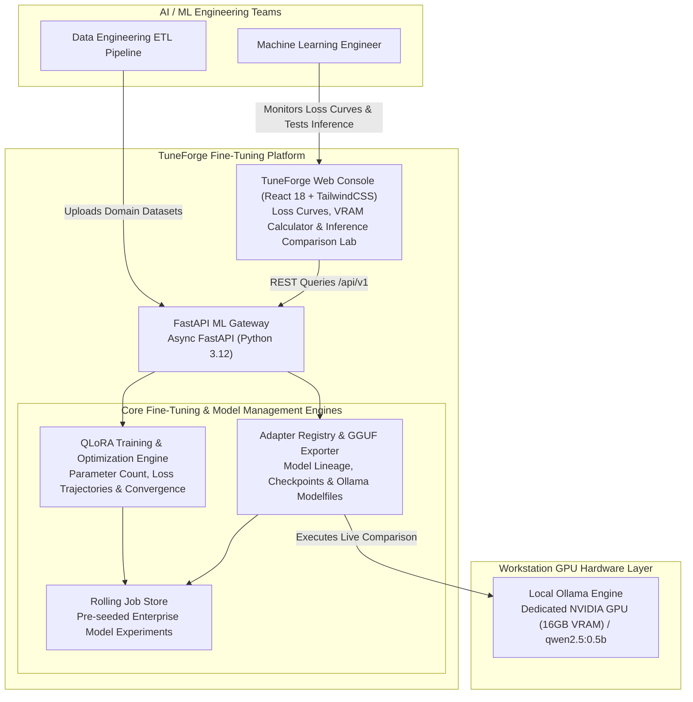
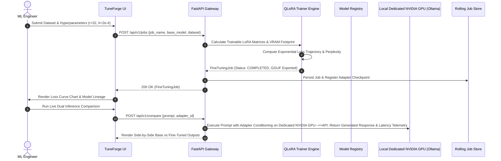

# TuneForge System Architecture & LLM Fine-Tuning Studio Design

TuneForge is an enterprise **Parameter-Efficient LLM Fine-Tuning Studio and Model Registry**. It orchestrates QLoRA (Quantized Low-Rank Adaptation) and DPO (Direct Preference Optimization) training workflows, computes mathematical loss trajectories, registers model checkpoints, and exports quantized GGUF adapters for local deployment.

---

## 1. C4 Container Diagram

---

## 2. Fine-Tuning & Model Export Sequence

---

## 3. Core Architectural Modules

### A. QLoRA Training Engine (`trainer_engine.py`)
- Calculates exact low-rank dimension weights for target projection matrices:
  $$N_{\text{trainable}} = 2 \times d_{\text{model}} \times r \times N_{\text{layers}} \times N_{\text{targets}}$$
- Estimates 4-bit NF4 memory footprints, confirming local execution fit on 16GB GPUs without host memory swapping.
- Computes deterministic power-law loss convergence curves:
  $$L(s) = L_{\infty} + (L_0 - L_{\infty}) e^{-\kappa s}$$

### B. Adapter Registry & Exporter (`registry_engine.py`)
- Tracks adapter checkpoints, parent base models, rank $r$, scaling factor $\alpha$, and final perplexity ($PPL = \exp(L_{\text{eval}})$).
- Formats GGUF metadata for immediate deployment to Ollama, llama.cpp, and vLLM runtimes.
- Integrates with workstation local Ollama instance for live side-by-side verification.
