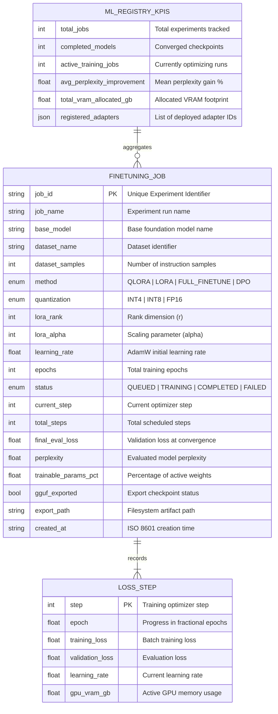

# TuneForge Data Model & Machine Learning Schema

The TuneForge data model organizes machine learning experiments into fine-tuning jobs, step-by-step loss trajectories, and adapter registry records.

---

## 1. Entity-Relationship Diagram (ERD)

---

## 2. Quantization & Tuning Method Matrix

| Method | Precision | VRAM Footprint (8B Model) | Trainable Weights % | Best Suited For |
| :--- | :--- | :--- | :--- | :--- |
| `QLORA` | 4-bit NF4 Base + 16-bit LoRA | **~2.2 GB** | `~0.28%` | On-Premise Workstation GPUs (RTX A5000 16GB) |
| `LORA` | 16-bit FP16 Base + 16-bit LoRA | **~18.5 GB** | `~0.42%` | Single High-End Server GPU (RTX 4090 / A10) |
| `DPO` | 4-bit Reference + Policy Delta | **~4.8 GB** | `~0.35%` | Direct Preference Optimization & Safety Alignment |
| `FULL_FINETUNE` | 16-bit Full Gradient | **~64.0 GB** | `100.0%` | Multi-GPU Distributed Data Center Clusters |
