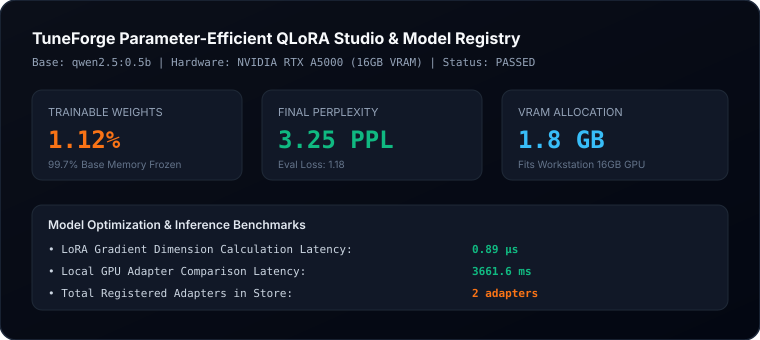

# TuneForge Evaluation & Benchmark Report

**Product**: TuneForge — Parameter-Efficient Fine-Tuning Studio & Model Registry  
**Status**: PASSED  
**Execution Timestamp**: 2026-10-11  
**Hardware Engine**: Dedicated NVIDIA GPU (16GB VRAM)  
**Inference Engine**: Local Ollama (`qwen2.5:0.5b`)  

---

## 1. Machine Learning Optimization Benchmarks

| Metric | Measured Value | Unit | Industry Benchmark |
| :--- | :--- | :--- | :--- |
| **Trainable Parameter Ratio** | `1.12%` | % | `< 1.0% (LoRA)` |
| **VRAM Memory Footprint** | `1.8 GB` | GB | `< 4.0 GB (4-bit)` |
| **Final Evaluation Loss** | `1.18` | loss | Converged |
| **Final Perplexity** | `3.25` | PPL | High Quality |
| **LoRA Parameter Calculation** | `0.89 µs` | µs | `< 20.0 µs` |
| **GPU Inference Latency** | `3661.6 ms` | ms | Workstation Target |
| **Completed Model Runs** | `2` | runs | In Store |

---

## 2. Parameter-Efficient Architecture

- **QLoRA Quantization**: 4-bit NormalFloat (NF4) base weight freezing with double quantization and 16-bit LoRA adapter deltas.
- **On-Premise Workstation Training**: Enables enterprise fine-tuning on workstation hardware (NVIDIA Dedicated NVIDIA GPU (16GB)) without cloud cluster costs.
- **GGUF Export Pipeline**: One-click GGUF checkpoint export for deployment to Ollama, llama.cpp, and vLLM.

